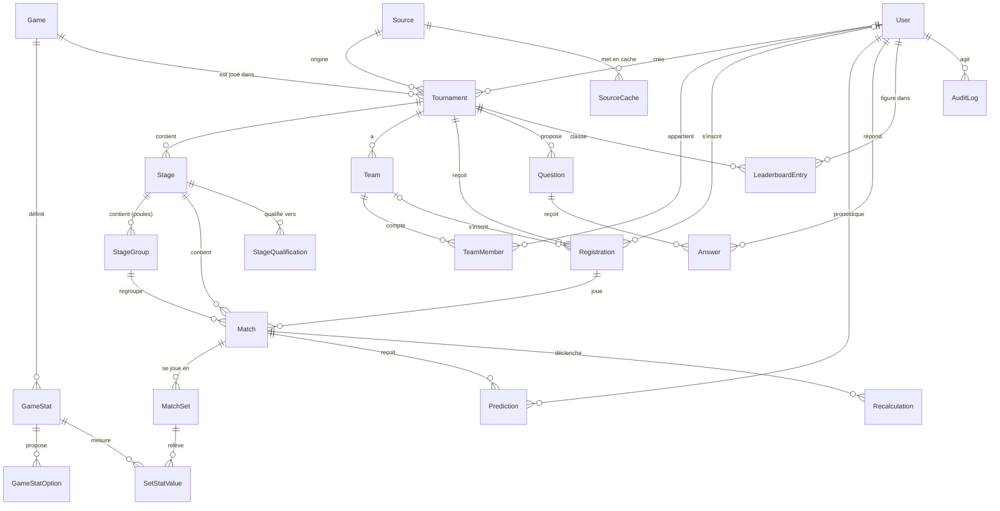

# Modèle de données

## 1. Principes de conception

1. **Un « joueur » n'est pas un type de compte.** Tout utilisateur connecté peut pronostiquer, et un joueur est simplement un utilisateur qui a une inscription. `User.role` ne distingue donc que `ADMIN` et `USER`.
2. **`Registration` représente un participant à un tournoi** (joueur solo ou équipe). C'est elle qui joue les matchs. Pour un tournoi importé, il n'y a pas de compte : `userId` est vide et `externalId` pointe vers la source.
3. **Internes et importés partagent le même modèle.** Un tournoi a une `Source` (`INTERNAL` ou `STARTGG`). Seule la source change : un tournoi importé est en lecture seule.
4. **Les classements et les points sont recalculables.** Les points sont stockés sur chaque pronostic et chaque réponse, le classement est une table matérialisée, et tout peut être reconstruit depuis les résultats.
5. **Tout ce qui est sensible est tracé** : `AuditLog` pour les actions, `Recalculation` pour les cascades.
6. **Les données variables sont en JSON** (configuration d'une étape, données brutes du connecteur), les données structurantes sont en colonnes typées.

## 2. Correspondance avec les entités du sujet

| Entité du sujet | Modèle |
|---|---|
| jeu | `Game` |
| statistique | `GameStat`, `GameStatOption` |
| tournoi | `Tournament` |
| étape | `Stage`, `StageGroup`, `StageQualification` |
| match | `Match` |
| manche | `MatchSet`, `SetStatValue` |
| équipe | `Team`, `TeamMember` |
| joueur | `User` (rôle `USER`) + `Registration` |
| inscription | `Registration` |
| pronostic | `Prediction` |
| question | `Question` |
| réponse | `Answer` |
| classement | `LeaderboardEntry` |
| source | `Source`, `SourceCache` |
| (exigences de sécurité) | `AuditLog`, `Recalculation` |

## 3. Schéma des entités

## 4. Description des entités

### Contenu et configuration

| Modèle | Rôle | Champs clés |
|---|---|---|
| `User` | Compte utilisateur | email, mot de passe haché, pseudo, rôle (`ADMIN`/`USER`) |
| `Game` | Jeu déclaré par l'admin (e-sport, babyfoot, échecs…) | nom, slug, logo |
| `GameStat` | Statistique relevée à chaque manche | clé, libellé, type (nombre, choix, texte, booléen), portée (participant ou manche) |
| `GameStatOption` | Valeur d'une liste configurable (champions, cartes) | statistique, valeur, libellé |
| `Source` | Origine des tournois (`INTERNAL`, `STARTGG`) | type, nom |
| `SourceCache` | Cache des réponses d'un connecteur | source, clé, contenu JSON, date de récupération, expiration |

### Tournoi

| Modèle | Rôle | Champs clés |
|---|---|---|
| `Tournament` | Tournoi interne ou importé | jeu, source, identifiant externe, dates, lieu, visibilité, mode (solo/équipe), taille d'équipe min/max, nombre de places, barème des pronostics, statut |
| `Stage` | Étape d'un tournoi, avec son format | position, format (élimination simple, poules), configuration JSON (seeding, départage, barème des poules, BO par tour), statut |
| `StageGroup` | Poule d'une étape de type poules | étape, nom |
| `StageQualification` | Règle de qualification entre étapes | étape source, poule, rang, étape cible, seed d'arrivée |
| `Team` | Équipe d'un tournoi interne | nom, capitaine, jeton d'invitation |
| `TeamMember` | Membre d'une équipe | équipe, utilisateur |
| `Registration` | Participant (solo ou équipe) | tournoi, utilisateur ou équipe, nom affiché, seed, statut, identifiant externe |

### Matchs et résultats

| Modèle | Rôle | Champs clés |
|---|---|---|
| `Match` | Rencontre entre deux participants | étape, poule, tour, position, BO, deux emplacements, horaires, statut, scores, vainqueur, forfait, match suivant (avancement de l'arbre) |
| `MatchSet` | Manche d'un match | numéro, scores, vainqueur, carte |
| `SetStatValue` | Valeur d'une statistique pour une manche | manche, statistique, participant concerné, valeur numérique ou texte |

### Pronostics et classements

| Modèle | Rôle | Champs clés |
|---|---|---|
| `Prediction` | Pronostic d'un utilisateur sur un match | vainqueur prédit, score prédit, points obtenus, date de résolution |
| `Question` | Pick'em personnalisé | modèle (`MOST_CHOSEN`, `TOP_STAT`, `YES_NO`), configuration JSON, points, date de clôture, statut, résolution, raison d'annulation |
| `Answer` | Réponse d'un utilisateur à une question | valeur JSON, juste ou fausse, points obtenus |
| `LeaderboardEntry` | Classement matérialisé par tournoi | tournoi, utilisateur, points, rang |

### Traçabilité

| Modèle | Rôle | Champs clés |
|---|---|---|
| `AuditLog` | Journal des actions sensibles (correction de score, création et résolution de Pick'em) | acteur, action, entité, valeur avant et après, date |
| `Recalculation` | Trace d'un recalcul en cascade | match d'origine, acteur, résumé JSON de ce qui a changé, dates |

## 5. Règles et invariants à respecter

- **Verrouillage** : un pronostic ne peut être créé ou modifié que si le match n'a pas commencé, selon l'horloge du serveur.
- **Unicité** : un utilisateur a au plus un pronostic par match, et une réponse par question.
- **Tournoi importé** : écritures interdites sur ses matchs, étapes et inscriptions (sauf par le connecteur).
- **Recalcul** : un recalcul en cascade s'exécute en une seule transaction et écrit une ligne `Recalculation`.
- **Classement général** : il n'est pas stocké, il se calcule en additionnant les points des classements par tournoi.
- **Classement des poules** : il n'est pas stocké non plus, le moteur le calcule à partir des matchs.

## 6. Questions ouvertes à trancher

1. **Début d'un match** : le verrouillage se base-t-il sur `scheduledAt` (heure prévue), sur `startedAt` (déclenché par l'admin), ou sur le premier des deux ?
2. **Double élimination et ronde suisse** (bonus) : le modèle actuel les supporte-t-il (match perdant qui descend, rondes dynamiques) ou faut-il ajouter `loserNextMatchId` ?
3. **Historique des scores** : suffit-il de `AuditLog` (avant/après) ou veut-on une table dédiée d'historique par match ?
4. **Participants importés** : correspondance entre un participant start.gg et un compte local (on ne la fait pas dans la première version).
5. **Questions `TOP_STAT`** : comment gérer les égalités (plusieurs joueurs avec le même nombre de kills) ?
